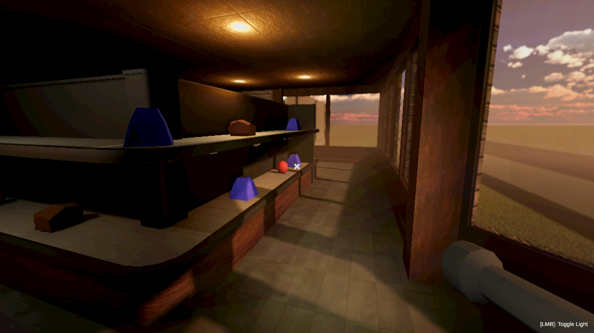
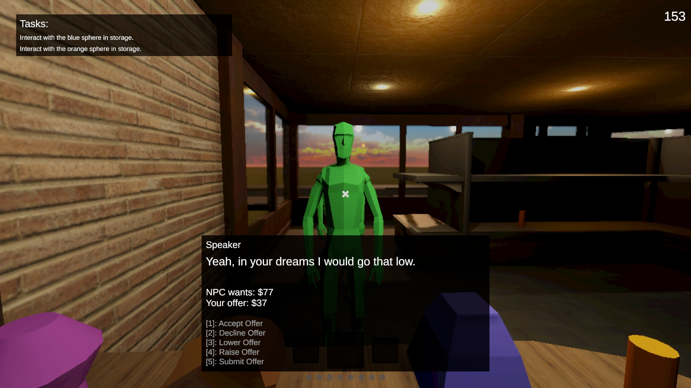
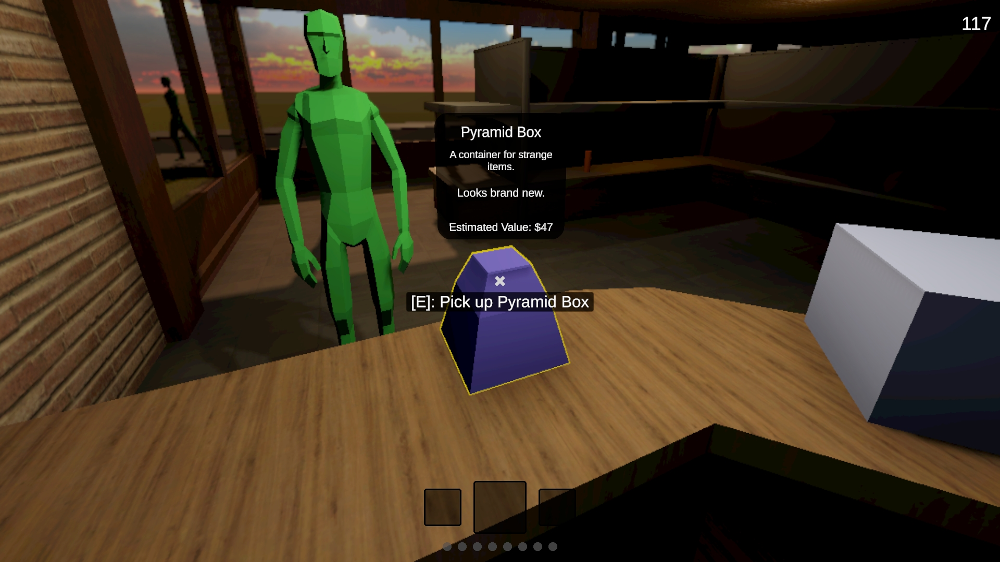
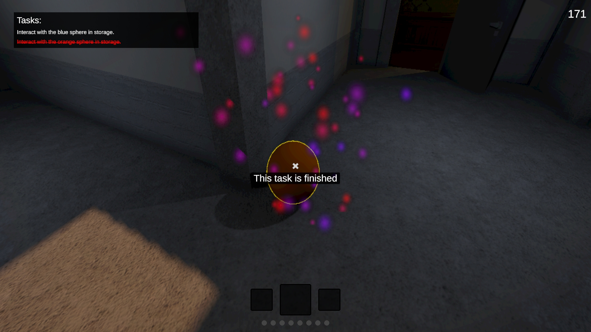
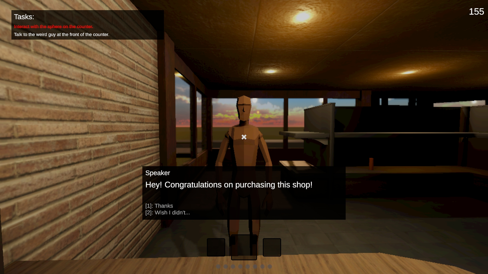

# Pawn Shop

Pawn Shop is a first-person horror game I'm currently developing in Unity. It combines running a small pawn shop with a story involving strange customers and weird/cursed objects.

**Details:** Unity/C#, scripts-only repository  
**Status:** In development  
**Snapshot:** October 2026

  
   
  <em>Prototype shop environment. Art and layout are still in development.</em>

This repository contains a snapshot of only the scripts I wrote and am working on from my project (10/13/2026). I plan to update this copy occasionally as the game reaches larger milestones.

## Gameplay

### Planned experience

I'm aiming for a short horror game of around 2-4 hours, with approachable shop management and a story that progresses through a series of days and nights.

Games that I'm getting inspiration from include The Boba Teashop, Kiosk, and the Mortuary Assistant.

### Current prototype

The scripts in this snapshot focus on the shop-management and progression systems that the story will build on.

Customers can bring items to the counter, where the player can accept their asking price, decline, or negotiate by adjusting and submitting an offer. Each sellable item has its own condition and pricing information, including its estimated value, purchase price, and listing price.

The current prototype includes:

- Customer behaviors for browsing shelves, choosing items, visiting the counter, and leaving.
- Dialogue choices and negotiations that respond to the player's offers.
- Item conditions, purchase prices, listing prices, and profit information.
- Inventory, item inspection, and placement previews.
- Day phases and task groups that control when objectives become available.
- Scene transitions and bed sequences that coordinate player setup.

| NPC negotiation | Item information |
| :---: | :---: |
|  |  |
| **Completed tasks** | **NPC welcome dialogue** |
|  |  |

These screenshots show working prototype systems. The characters, items, and parts of the interface are still placeholders. The complete story and planned horror sequences are still in development while I continue pursuing my CS degree.

## Code Tour

These scripts are good starting points for looking through the project:

| Starting point | What to look for |
| --- | --- |
| [GenericShopperBrain.cs](Scripts/Features/Entities/Brain/GenericShopper/GenericShopperBrain.cs) | Coordinates a shopper's decisions, including browsing, selecting items, checking out, and leaving. Movement, inventory, dialogue, and buying decisions are handled by supporting states, modules, and services. |
| [NegotiationSession.cs](Scripts/Features/Entities/State/Shopping/CounterInteractions/Negotiation/NegotiationSession.cs) and [NegotiationService.cs](Scripts/Features/Entities/State/Shopping/CounterInteractions/Negotiation/NegotiationService.cs) | Separate the state of an individual negotiation from the rules used to evaluate offers. Seller profiles control acceptance thresholds, offer limits, and the chance of accepting an offer below the desired price. |
| [Item.cs](Scripts/Features/Items/Data/Runtime/Item.cs) and [ItemPricing.cs](Scripts/Features/Items/Data/Runtime/ItemPricing.cs) | Separate shared item definitions from individual items' runtime state, including condition and pricing information. |
| [HeldItemHandler.cs](Scripts/Features/Player/Interactions/HeldItemHandler.cs) and [PlaceableLocation.cs](Scripts/Features/Interaction/PlaceableLocation/PlaceableLocation.cs) | Handle picking up and placing items, updating the inventory, and checking placement restrictions. |
| [TaskController.cs](Scripts/Features/Tasks/TaskController.cs) | Determines task availability using the current day phase and prerequisite groups. Tasks with the same order can be completed in any order before the next group becomes available. |
| [SceneSwapManager.cs](Scripts/Core/SceneManagement/SceneSwapManager.cs) | Keeps the screen covered during loading while registered scene objects finish their setup and report that they are ready. |

## Looking Back

### Building on They Watch

[They Watch](https://github.com/connor-gt/TheyWatch-Scripts) taught me how difficult a larger project could become when useful functionality lived in the wrong classes or behavior was spread across too many parent classes.

One specific example was its `LookAtTarget(...)` method, which lived inside the entity state hierarchy. In Pawn Shop, that kind of rotation behavior lives in [GameObjectUtils.cs](Scripts/Core/Utils/GameObjectUtils.cs) as `RotateTowardsTarget(...)`, so different systems can use it without inheriting from an entity state.

I'm also giving NPC decisions, reusable states, and supporting modules clearer responsibilities. For example, for NPC brains I wanted the brains to handle high-level decision-making like where to go, what to do, order of operations, etc. while not having to repeat actual logic, so I've created atomic states that do one thing and do it well, modules that brains delegate specific tasks to, and services that brains can implement when they need it (e.g., a seller NPC with a seller brain needing SellerService while a buyer NPC can use BuyerService).

### Expanding the economy and handling startup

[Crazy Runner](https://github.com/connor-gt/CrazyRunnerV2-Scripts) introduced me to building an in-game economy through its gem balance, shop, and purchases. Pawn Shop makes buying and selling a central part of the gameplay, with individual item conditions, customer preferences, and negotiations affecting each transaction.

Crazy Runner also had startup dependencies that meant I needed to enter through the main menu when testing gameplay. In Pawn Shop, [Bootstrapper.cs](Scripts/Core/System/Bootstrapper.cs) creates shared systems before the first scene loads, while the scene readiness system handles setup that needs to finish before the player sees the scene.

### Keeping the design focused

Planning Pawn Shop has also made me think more carefully about what each system contributes to the game. I started with a lot of ideas for random curse effects and additional management mechanics, but the current direction gives important objects and horror events their own place in the story.

Randomness can give ordinary shop activity some variety, while scripting lets me decide when a story moment happens and how the player experiences it. Keeping those purposes clear helps me decide which systems are worth building.

**This is still a project in progress.** My focus is on connecting the current systems into a complete game, with clear instructions, a familiar daily routine, and horror moments that build on that familiarity.

I'm also documenting responsibilities and assumptions earlier than I did in my previous projects. That has become useful as more systems interact, especially when something depends on scene initialization, an NPC's current state, or the item the player is holding.

Another change in my programming and architecture style from my previous projects is that I'm using public properties a lot more (most times with a private setter), and this has been a lot more helpful than making everything private because one thing I've learned with games in particular is that objects constantly rely on other objects' states, and being able to even view another object's state is a big help and makes responsibilities and flows a lot clearer.
